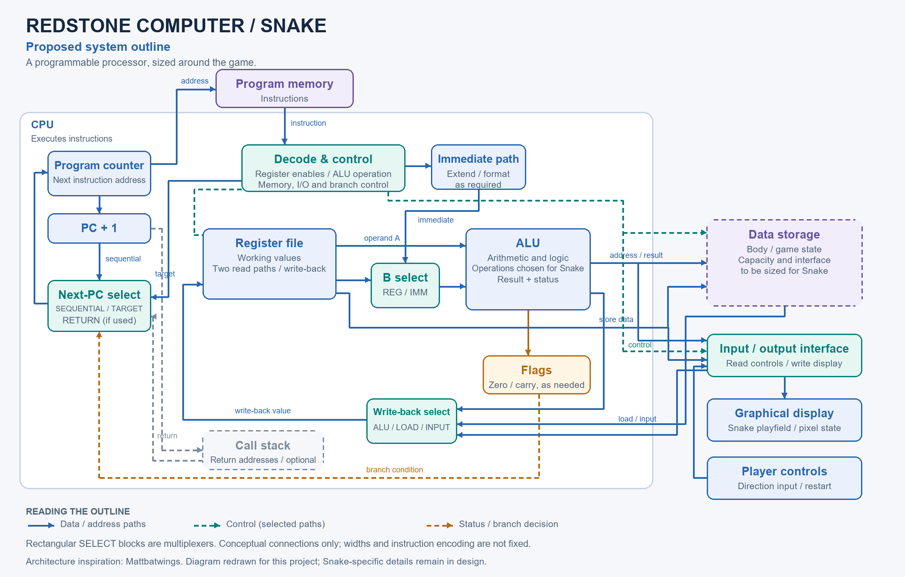

# Minecraft Redstone Computer

I'm building a Redstone computer to run Snake on a graphical display with player controls. I started with an 8-bit calculator to practice arithmetic logic, binary-to-decimal conversion, and display circuitry, and to finish a working project before building the computer. This repository contains the calculator, standalone circuits, and plans for the Snake computer.

[Watch the demonstration](https://youtu.be/XQKjd9Awp-k) · [Download the world](https://github.com/rosatij1/Minecraft-Redstone-Computer/releases/tag/v0.1.0)

## Completed practice build: 8-bit calculator

The calculator takes two unsigned 8-bit numbers, from 0 to 255, entered with levers. It supports:

- Addition and subtraction, including negative answers
- Multiplication and division by 2 using bit shifts
- Half-value results, displayed as `.5`
- Binary output and a decimal seven-segment display

The output has 12 bits: 10 for the whole-number magnitude, one for the negative sign, and one worth 0.5. Subtraction uses two's complement internally. Negative answers are then converted to a separate sign and magnitude for display.

The circuit is combinational, so the answer updates when an input or operation switch changes. There is no clock or calculate button; just allow time for the signals to settle. The multiply stage comes before the divide stage. Turning on both leaves the original arithmetic result unchanged.

The left input bank is A and the right is B. Subtraction calculates `A − B`. See the [calculator documentation](calculator/README.md) for controls, output representation, and circuit design.

## Download and run

**Minecraft Java Edition 1.18.2 — tested in vanilla, with no mods required.**

1. Download [redstone-computer-v0.1.0-mc1.18.2.zip](https://github.com/rosatij1/Minecraft-Redstone-Computer/releases/download/v0.1.0/redstone-computer-v0.1.0-mc1.18.2.zip).
2. Extract the ZIP and find the world folder containing `level.dat`.
3. With Minecraft closed, copy that entire folder into your installation's `saves` folder. On a default Windows installation, press Windows+R and enter `%appdata%\.minecraft\saves`.
4. Launch Java Edition 1.18.2 and open the world from Singleplayer.
5. Set the calculator's input levers and operation switches, then allow the output to settle.

I used WorldEdit to place vanilla blocks and Carpet to speed up ticks and fly through walls while building and testing. Neither mod is required to run the world.

## Explore the project

- [Snake computer design](design/README.md) — game requirements, CPU structure, storage, and design direction
- [Calculator](calculator/README.md) — controls and arithmetic, conversion, and display stages
- [Calculator gallery](calculator/COMPONENTS.md) — circuits installed in the assembled build
- [Standalone component library](components/README.md) — gates, adders, multiplexers, and display circuits
- [Demonstration](calculator/videos/README.md) — video and example results

## Next stage

I'm working backward from Snake to decide what to build next. Moving the snake, storing its body, placing food, checking collisions, and updating the screen will determine the instructions and hardware I need.

I'm following Mattbatwings' [Let's Make a Redstone Computer! series](https://www.youtube.com/playlist?list=PL5LiOvrbVo8nPTtdXAdSmDWzu85zzdgRT) to learn how the parts fit together, then adapting the design for Snake.

The outline above shows the planned computer, based on Mattbatwings' architecture. SELECT blocks are multiplexers.

The CPU will contain the program counter, control circuitry, register file, ALU, flags, and multiplexers. Program memory will supply its instructions. I'm keeping data storage and a call stack in the outline while I work out what Snake needs. Player controls and the graphical display connect to the processor through an input/output interface.

The [design page](design/README.md) explains each block. I haven't fixed the word widths, instruction encoding, storage capacity, or screen dimensions yet. The current world download contains the calculator; the CPU and Snake are still to come.
