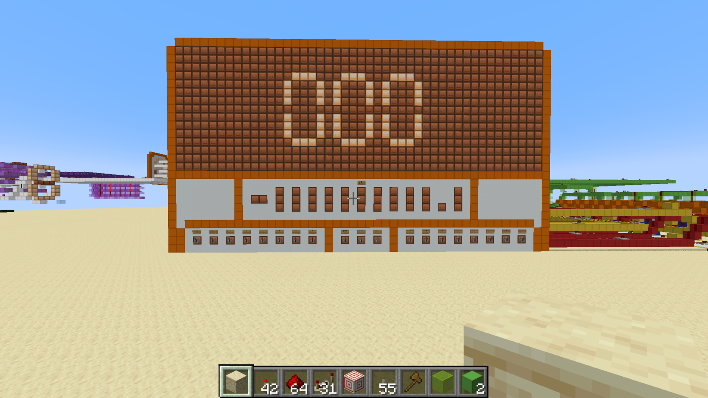

# Minecraft Redstone Computer

This repository documents an ongoing computer build made in Minecraft with Redstone. The project is still in development. Its most complete subsystem is a working 8-bit calculator, which serves as a step toward the larger computer.

## Current progress

The calculator accepts two unsigned 8-bit values (0–255), entered manually in binary using levers. It uses combinational logic: the output updates automatically after signals propagate through the Redstone circuitry, with no clock or calculate button.

The calculator can:

- Add two 8-bit numbers
- Subtract two 8-bit numbers using two's complement, with a second adder producing the magnitude of negative results
- Multiply the arithmetic result by 2 with a left bit shift
- Divide the arithmetic result by 2 with a right bit shift, displaying `.5` for odd results
- Produce a 12-signal output: 10 whole-number magnitude bits, one negative-sign bit, and one half-value bit
- Convert binary output to BCD with the double dabble algorithm
- Drive a decimal seven-segment display through individual digit decoders, with a simplified thousands indicator and fixed minus-sign and `.5` patterns

Three control switches select addition or subtraction, enable multiplication by 2, and enable division by 2. The front panel includes binary output with a negative indicator and a large seven-segment display above it.

The shift controls act on the addition or subtraction result. Enabling both cancels the shifts and leaves that result unchanged.

Facing the panel, input A is on the left and B is on the right. Subtraction calculates `A − B`. Both inputs are nonnegative; negative answers are produced by subtraction.

See the [calculator README](calculator/README.md) for its operation and circuit design, and the [component library](components/README.md) for standalone gates and circuits.

## Project status

The calculator features above are working. The full computer and CPU are planned work, so their design and specifications are not documented as finished features yet.

### Planned development

- Build the calculator into a larger computer architecture
- Develop and document the CPU
- Record how the major subsystems connect
- Add diagrams, screenshots, and demonstration videos
- Document controls, inputs, outputs, and operating steps

## Gallery

The working calculator's front panel. The two binary inputs sit along the bottom, with three operation switches between them. The binary result and negative indicator sit above the controls, below the large display.

A silent demonstration is available on YouTube: [Watch the calculator demonstration](https://youtu.be/XQKjd9Awp-k). See the [video notes](calculator/videos/README.md) for review status.

## Repository contents

- [`calculator/README.md`](calculator/README.md) — working calculator subsystem
- [`calculator/COMPONENTS.md`](calculator/COMPONENTS.md) — components installed in the assembled calculator
- [`components/README.md`](components/README.md) — library for standalone gates and reusable circuits
- [Minecraft world download](https://github.com/rosatij1/Minecraft-Redstone-Computer/releases/tag/v0.1.0) — tested vanilla Java Edition 1.18.2 world
- `calculator/images/` — calculator screenshots
- [`calculator/videos/`](calculator/videos/README.md) — demonstration video location and upload status

## Running the world

The build uses **Minecraft Java Edition 1.18.2**. The builder tested a copy of the world in vanilla 1.18.2 and confirmed that it works without mods.

WorldEdit was used to place vanilla blocks during construction. Carpet was used to speed up game ticks and allow movement through walls while building and testing. Neither mod is required to run the tested world. At normal tick speed, allow the calculator's signals to settle before reading the output.

### Installing the world download

1. Download [redstone-computer-v0.1.0-mc1.18.2.zip](https://github.com/rosatij1/Minecraft-Redstone-Computer/releases/download/v0.1.0/redstone-computer-v0.1.0-mc1.18.2.zip) from the [v0.1.0 release](https://github.com/rosatij1/Minecraft-Redstone-Computer/releases/tag/v0.1.0).
2. Extract the ZIP.
3. Find the extracted world folder containing `level.dat`. Copy that entire folder, including its subfolders.
4. With Minecraft closed, place the world folder in your Java Edition installation's `saves` folder. For the default Windows installation, press Windows+R and enter `%appdata%\.minecraft\saves`. Custom launcher installations may use a different game directory.
5. Launch vanilla Minecraft Java Edition 1.18.2, choose Singleplayer, and open the imported world.
6. Use the input levers and operation switches described in the [calculator instructions](calculator/README.md#front-panel-and-operation). Allow the output to settle before reading it.

The calculator's coordinates or directions from the starting position still need to be documented.

### Documentation status

- [x] Confirm the Minecraft edition: Java Edition 1.18.2
- [x] Confirm the world runs without WorldEdit or Carpet: builder-tested in vanilla 1.18.2
- [ ] Document any required resource packs or settings
- [x] Link the published calculator demonstration
- [x] Add world installation instructions
- [x] Link the published v0.1.0 release and its world ZIP; attachment verified on GitHub
- [ ] Explain where the computer is located after the world loads
- [x] Add reviewed example results in the [video notes](calculator/videos/README.md)

## About this repository

This repository is both a record of the build process and a portfolio project. It will be updated as more of the computer is designed, built, tested, and documented.

