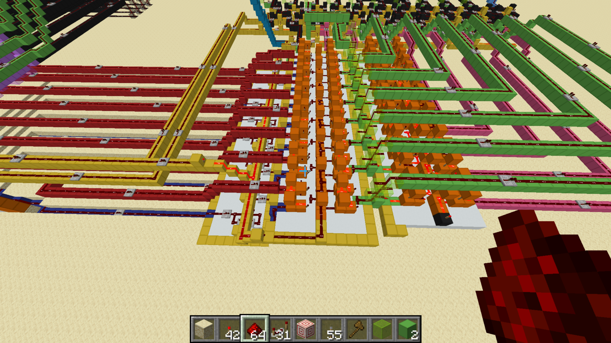
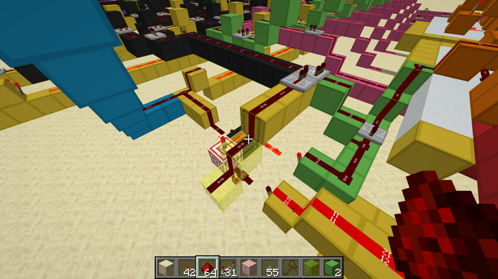
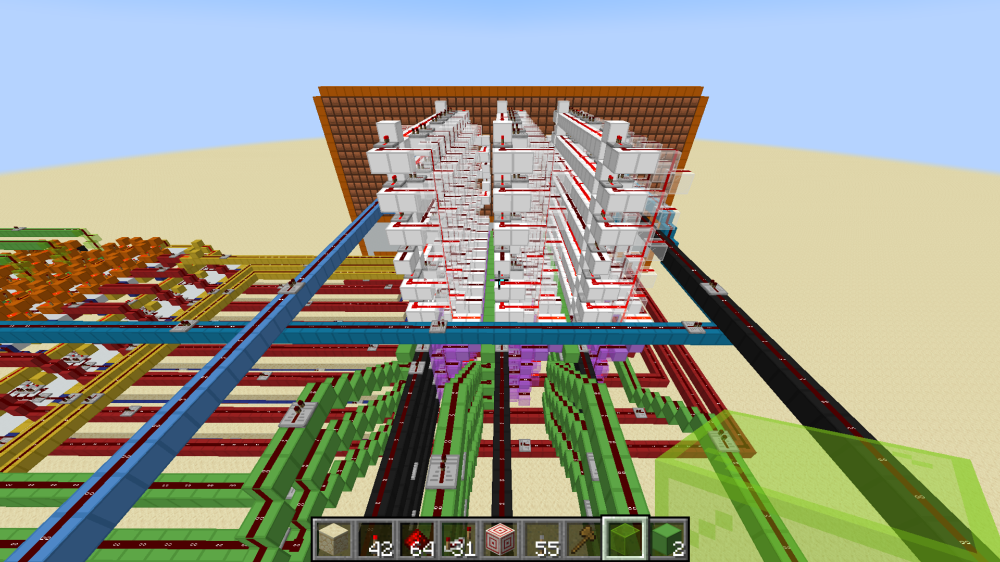
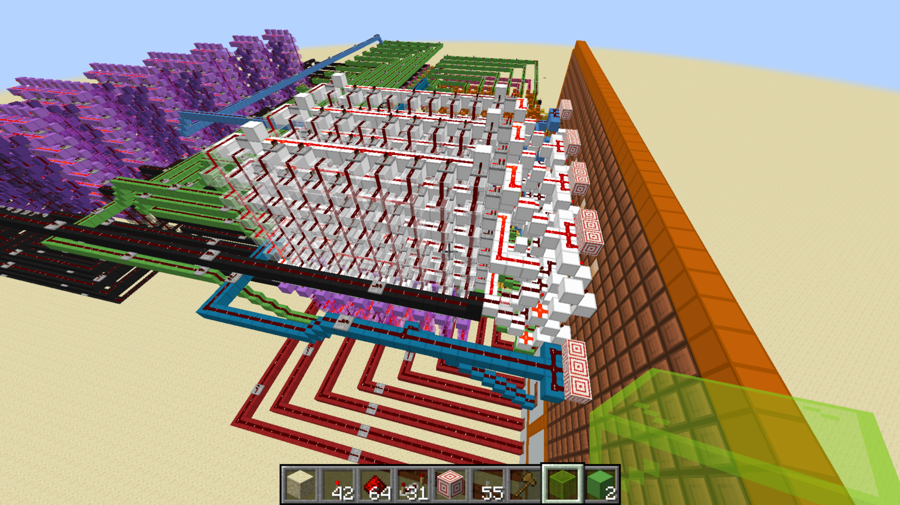
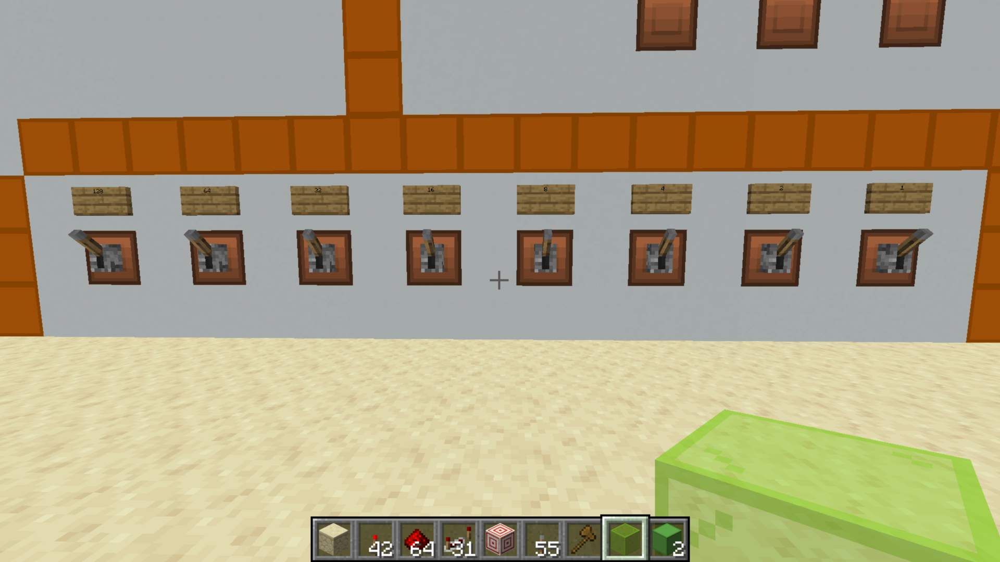
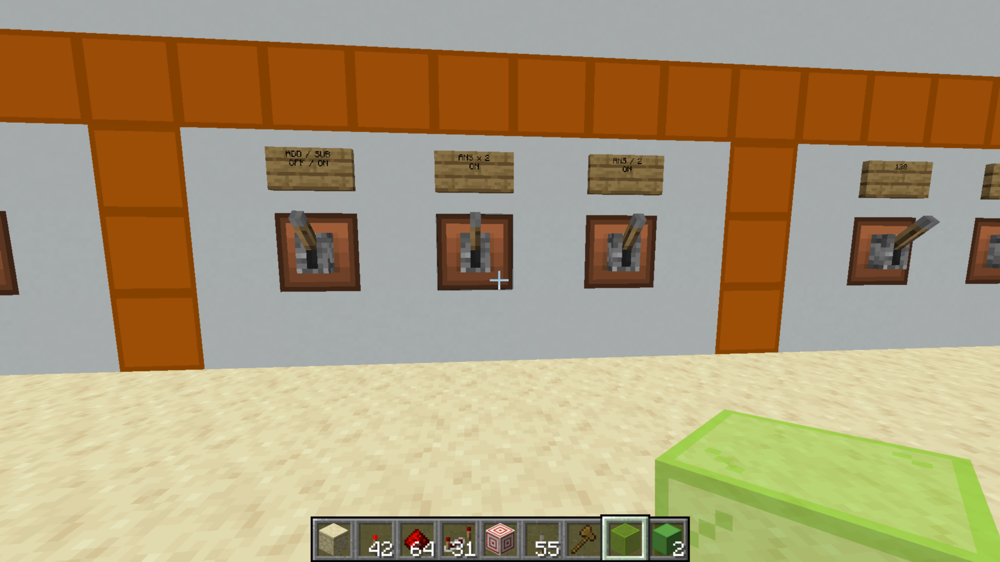

# Calculator Component Gallery

[Project overview](../README.md) · [Calculator description](README.md) · [Standalone component library](../components/README.md)

These screenshots show components installed in my completed calculator practice build and its front panel. I used this project to learn arithmetic logic, binary conversion, and display circuitry before designing the [Snake computer](../design/README.md). Separate demonstration circuits and layout models are kept in the [standalone component library](../components/README.md).

## Two-adder arithmetic stage in the calculator

The blue wiring carries the second input, B, into the conditional inversion circuitry. In subtraction mode, B is inverted and a carry-in of 1 is supplied to the first adder, forming `A + ~B + 1`.

If the result is negative, the second adder converts it to a positive magnitude by inverting it and adding 1. The magnitude-selection multiplexer chooses the second result for negative subtraction answers and the first result otherwise. This stage comes before the multiply/divide multiplexers.

## Negative-result detector in the calculator

The green path carries the first adder's carry-out. The yellow path carries the addition/subtraction control. The detector combines subtraction enabled with the inverse of carry-out:

`negative = subtract_enabled AND NOT first_adder_carry_out`

| Subtraction enabled | First carry-out | Negative signal |
| --- | --- | --- |
| No | Off | Off |
| No | On | Off |
| Yes | Off | On |
| Yes | On | Off |

During subtraction, a missing carry-out indicates a borrow: A is smaller than B. This enables the negative sign and selects the second adder's magnitude. Carry-out here is an unsigned carry/borrow indication, rather than signed overflow.

For `3 − 8`, carry-out is off, the negative signal is on, and the selected magnitude is 5.

## Display circuitry in the assembled calculator

These views show the digit-decoding and segment circuitry implemented behind the calculator's display. The double dabble converter supplies the whole-number digit values, while the sign and half-value signals control their fixed patterns separately.

## Assembled front panel

Facing the panel, the left input bank is A and the right is B. Each bank accepts 0–255, with bit weights descending from 128 on the left to 1 on the right. Negative inputs are not supported.

The central controls run left to right: ADD / SUB (off for addition, on for subtraction), ANS × 2, and ANS / 2. Subtraction calculates A minus B.

The front panel brings the inputs, operation controls, binary output, sign indication, and seven-segment display together. The final result has 10 whole-number magnitude bits, a separate negative-sign bit, and a fractional bit worth 0.5.

The fractional bit directly enables a fixed `.5` display. When the bit is off, the fractional display is blank.

## Display design credit

I used Mattbatwings' [display-design tutorial at 20:25](https://www.youtube.com/watch?v=mDLfUbAK9T0&t=1225s) as a reference for the binary-to-decimal display design.
