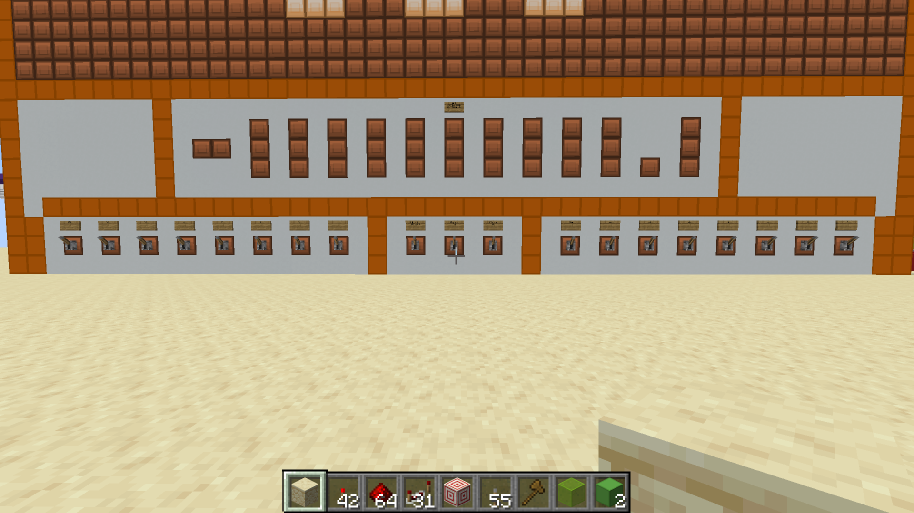

# 8-Bit Calculator Subsystem

[Back to the main project README](../README.md) · [Standalone component library](../components/README.md)

[Video folder and demonstration status](videos/README.md)

The calculator is a working subsystem in the larger Minecraft Redstone computer project. It accepts two unsigned 8-bit numbers, each from 0 to 255, entered manually in binary. It performs arithmetic and bit-shift operations and shows the result through binary indicators and a seven-segment display.

## Confirmed working features

| Feature | Current behavior |
| --- | --- |
| Addition | Adds two 8-bit numbers |
| Subtraction | Subtracts two 8-bit numbers using two's complement in the ALU |
| Multiply by 2 | Shifts the arithmetic result left |
| Divide by 2 | Shifts the arithmetic result right and displays `.5` for an odd result |
| Both shift controls enabled | The shifts cancel, leaving the arithmetic result unchanged |
| Result handling | 12 output signals: 10 whole-number magnitude bits, one sign bit, and one half-value bit |
| Binary-to-BCD conversion | Converts 10 magnitude bits into four decimal digit positions using double dabble |
| Display output | Separate digit decoders and segment wiring; thousands position shows 1 or stays blank |
| Automatic updates | Uses combinational logic; no clock or calculate button is needed |

## Front panel and operation

Facing the front panel, the left bank of eight levers is input A and the right bank is input B. Both inputs are unsigned values from 0 to 255; negative numbers cannot be entered directly. Subtraction calculates `A − B`, so the output can still be negative.

Within each bank, the bit weights run from left to right as `128, 64, 32, 16, 8, 4, 2, 1`. Turn on the levers whose weights sum to the desired value. For example, 13 uses the 8, 4, and 1 levers, giving binary `00001101`.

Three control switches sit between the input banks. From left to right:

| Sign label | Off | On |
| --- | --- | --- |
| ADD / SUB | Addition: `A + B` | Subtraction: `A − B` |
| ANS × 2 | No multiplication | Multiply the arithmetic result by 2 |
| ANS / 2 | No division | Divide the result after the multiply stage by 2 |

Here, on means the lever's powered state. With both shift controls on, multiplication and division cancel.

Above the controls, the binary output includes a negative indicator. The large seven-segment display sits at the top of the panel.

The calculator uses **combinational logic**. Changing an input or operation switch automatically changes the output after the Redstone signals propagate and settle. There is no clock or separate button to trigger a calculation. The settling time has not yet been measured.

To use the calculator, enter A and B in binary with their lever banks, select addition or subtraction, and set the shift controls as needed. Allow the output to settle before reading the result.

## How the calculator is organized

The signal path runs through the two-adder arithmetic stage, a magnitude-selection multiplexer, the multiply/divide shift stages, and the output-conversion and display circuitry. A separate negative-result signal controls the sign indication.

### Arithmetic logic unit

The ALU uses two ripple-carry adders. Each bit's carry feeds the next more significant bit, so the carry propagates through the adder. The first adder performs the requested addition or subtraction. The second converts a negative subtraction result into a positive magnitude for the downstream circuitry.

In addition mode, the first adder calculates `A + B`, and its result is selected. Addition can require a ninth result bit.

In subtraction mode, B's bits are inverted and the first adder receives a carry-in of 1, giving `A + ~B + 1`. The negative detector combines the subtraction control with the inverted carry-out:

`negative = subtract_enabled AND NOT first_adder_carry_out`

During subtraction, no carry-out means that A is smaller than B. If the negative detector is on, the first result is inverted and 1 is added through the second adder to obtain its positive magnitude. A multiplexer selects this second result for negative answers and the first result otherwise. The negative signal is kept separate from the selected magnitude.

For example, with `3 − 8`, the first adder has no carry-out, so the negative detector turns on. The second adder produces a magnitude of 5, and the separate sign signal indicates a negative answer. The magnitude then enters the multiply/divide shift stages.

See the [calculator component gallery](COMPONENTS.md) for circuitry installed in the calculator, and the [standalone component library](../components/README.md) for the separate four-bit adder and multiplexer examples.

### Bit-shift operations

The shift controls act on the result of addition or subtraction, before output conversion and display. Multiplexers select between the shifted and unshifted signal paths.

The multiply-by-2 stage comes first. When enabled, it moves the result's bits one position to the left. Its output feeds the divide-by-2 stage, which moves the bits one position to the right when enabled. With both controls enabled, the shifts cancel and the original arithmetic result is preserved.

| Multiply by 2 | Divide by 2 | Output |
| --- | --- | --- |
| Off | Off | Original arithmetic result |
| On | Off | Arithmetic result multiplied by 2 |
| Off | On | Arithmetic result divided by 2 |
| On | On | Original arithmetic result |

The integer magnitude has 10 bits to accommodate multiplication by 2. In the divide-by-2 stage, the least significant whole-number bit shifts into a separate fractional position with a weight of one half. This preserves an odd result's remainder: binary `0.1` equals decimal `0.5`. The fractional bit enables a fixed `.5` display when set; when clear, that display is blank. This division is a shift toward lower place values, conventionally called a right shift, regardless of the wiring's physical direction in Minecraft.

### Output representation

The final output consists of 12 signals:

| Field | Signals | Meaning |
| --- | --- | --- |
| Negative sign | 1 | Indicates a negative answer |
| Whole-number magnitude | 10 | Unsigned whole-number part of the answer |
| Fraction | 1 | Adds `0.5` to the magnitude when set |

The sign is separate from the magnitude and fraction. Although subtraction uses two's complement internally, the final output is a sign-and-magnitude representation with one fractional bit. The 12 signals are therefore not a single 12-bit two's-complement integer.

For example, dividing a magnitude of 5 by 2 produces a whole-number magnitude of 2 and a half-value bit of 1, representing 2.5. Negative odd-result division still needs an example recorded from the running build.

### Binary-to-BCD conversion

The calculator uses the **double dabble**, or shift-and-add-3, algorithm to convert its 10 whole-number magnitude bits into decimal digit positions for thousands, hundreds, tens, and ones. A standard BCD digit uses four bits to encode a value from 0 through 9; four decimal digits are different from four binary bits. The thousands position only needs to represent 0 or 1 for a 10-bit magnitude.

During the conversion, the binary value is shifted through a sequence of stages. Before each shift, any BCD digit that is 5 or greater has 3 added to it. Repeating that process produces the decimal digits in BCD form. The separate sign and half-value signals bypass this conversion.

The separate layout model and standalone converter are documented on the [converter page](../components/double-dabble/README.md). A dedicated close-up of the converter installed in the calculator can be added when available.

### Seven-segment output

Each of the hundreds, tens, and ones digits has its own decoding circuitry. The purple circuit decodes the digit's four BCD input bits into one of ten digit-selection signals, representing 0 through 9. The white wiring maps the selected digit to the segments that must light up.

The thousands position has a simplified driver: it shows a fixed 1 when needed and otherwise stays blank. This accommodates results above 999, such as the mathematically expected maximum of `(255 + 255) × 2 = 1020`; a recorded test of that maximum is still to be added.

The hundreds, tens, and ones positions retain leading zeros. With the thousands position blank, five therefore appears as `005` preceded by a blank position, rather than four illuminated digits reading `0005`.

The negative signal enables a fixed minus-sign pattern. When the signal is off, that pattern is hidden. The front panel also exposes a binary result and a negative indicator below the main display.

The fractional output uses a fixed `.5` pattern controlled directly by the half-value bit. It appears when that bit is on and is hidden when it is off. It does not pass through the binary-to-BCD converter or a separate numerical decoder.

See the [installed display gallery](COMPONENTS.md#display-circuitry-in-the-assembled-calculator) for another view of the implemented circuitry. The separate demonstration decoder is on the [display component page](../components/seven-segment-display/README.md).

## Suggested demonstrations

Add screenshots or short videos showing:

- A basic addition example
- A subtraction with a positive result
- A subtraction with a negative result
- A calculation that uses the ninth result bit
- Multiplication by 2 with a left shift
- Division of an odd result by 2, showing the `.5` output
- Both shift controls enabled, showing that the original result is preserved
- A result that uses the tenth output bit after multiplication
- The input, conversion, and display stages in one continuous demonstration

## Design references and credits

Mattbatwings' YouTube videos were a main reference during the build, including for some decoder designs. The builder identifies [this display-design tutorial, linked at 20:25](https://www.youtube.com/watch?v=mDLfUbAK9T0&t=1225s), as the reference for the binary-to-decimal display design. Additional circuit-specific sources can be added as they are identified.

## Documentation TODOs

- [ ] Document how the double dabble stages are arranged and timed
- [ ] Record intermediate adder bit widths and sign wiring to each display
- [ ] Label each front-panel output indicator with its bit weight or role
- [ ] Test and document overflow and underflow behavior
- [ ] Test and document bit shifts for signed values and values at the 8-bit limit
- [ ] Credit any other reused circuit designs as their sources are identified
- [ ] Add labeled screenshots of each major circuit
- [ ] Add example calculations with expected and observed outputs
- [ ] Upload and review the recorded silent demonstration

## Relationship to the full computer

This calculator is a working subsystem and a foundation for the planned computer. The full CPU architecture, instruction set, memory, control logic, and other computer specifications have not been confirmed and should be documented as they are designed and tested.
