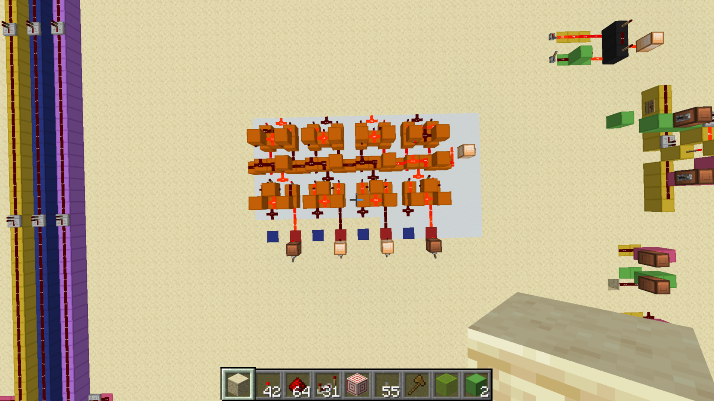
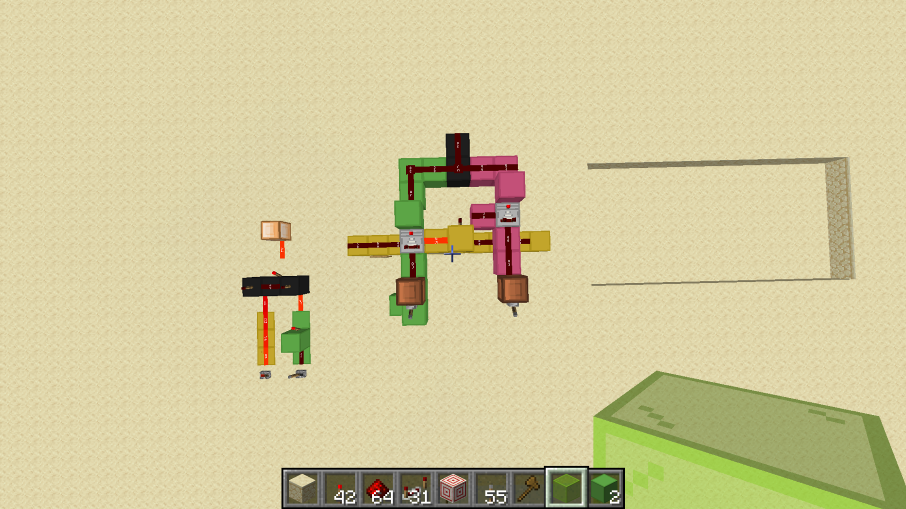
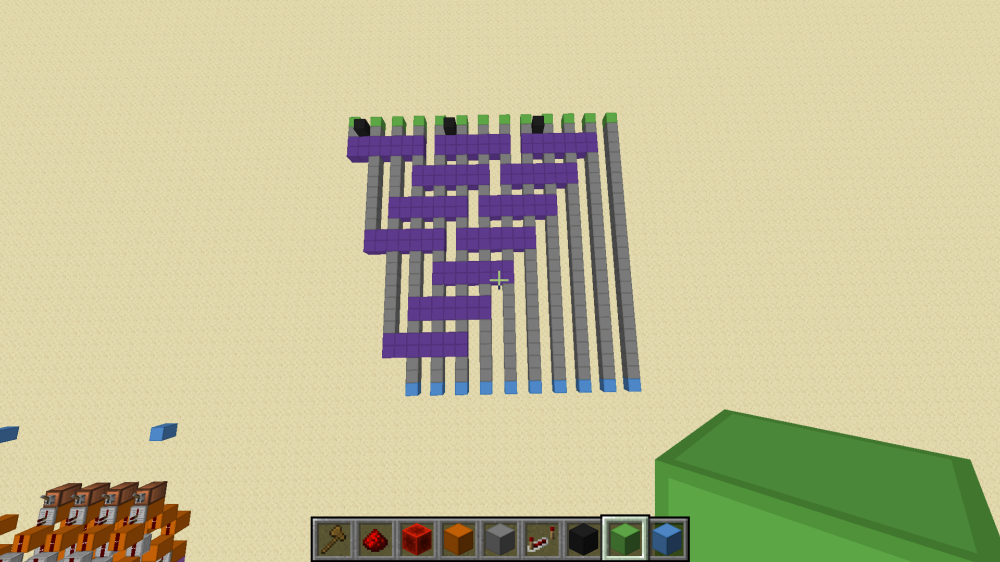
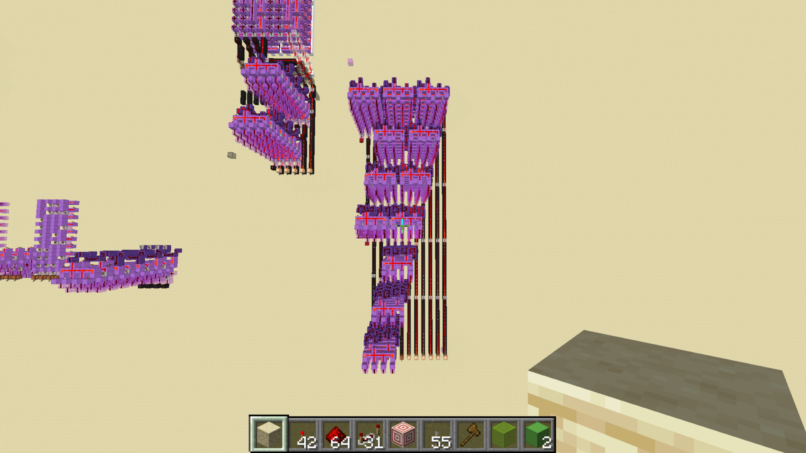
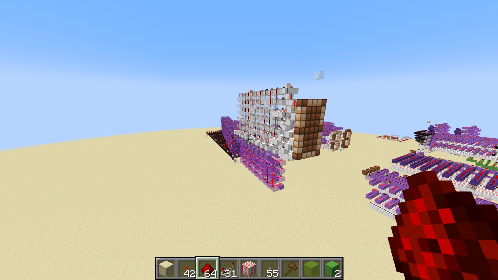
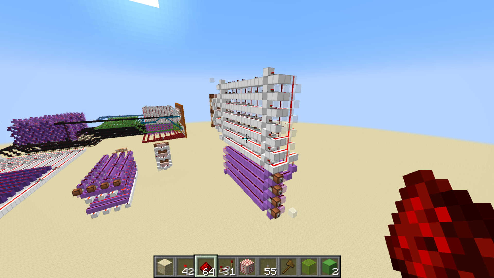

# Standalone Circuit Gallery

[Project overview](../README.md) · [Working calculator](../calculator/README.md)

These standalone examples illustrate reusable logic circuits. They are separate from the assembled calculator; see the [calculator component gallery](../calculator/COMPONENTS.md) for the installed circuits. Individual gates and other examples are listed in the [component library](README.md).

## Four-bit ripple-carry adder

This separate four-bit example illustrates the ripple-carry design. Carry propagates from each bit to the next more significant bit. The calculator uses two adders in its arithmetic stage; see the [implemented arithmetic circuitry](../calculator/COMPONENTS.md#two-adder-arithmetic-stage-in-the-calculator).

## Multiplexer

A multiplexer selects between two input paths. The calculator uses multiplexers for magnitude selection and shift control. This screenshot shows the standalone example, rather than one installed in the calculator.

## Double dabble converter

The layout model shows the repeated shift-and-conditional-add-3 stages, marked by purple bars.

This built module is separate from the calculator and is not connected to it in this view. See the [calculator conversion description](../calculator/README.md#binary-to-bcd-conversion) for its role in the output path.

## Digit decoder and seven-segment wiring

These are two views of a separate demonstration component. Purple circuitry decodes four BCD bits into one of ten digit selections, 0 through 9; white wiring maps that selection to the display segments. See the [installed display circuitry](../calculator/COMPONENTS.md#display-circuitry-in-the-assembled-calculator) for its implementation in the calculator.

I used Mattbatwings' [display-design tutorial at 20:25](https://www.youtube.com/watch?v=mDLfUbAK9T0&t=1225s) as a reference for the display.
