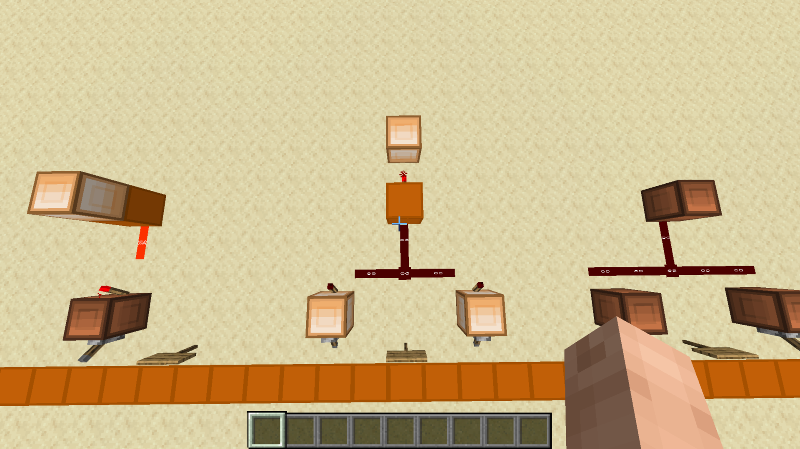

# AND Gate

[Component library](../README.md) · [Project overview](../../README.md)

An AND gate outputs 1 only when both inputs are 1.

The central circuit is the AND example. The two lower lever-controlled indicators provide its inputs; the upper indicator shows the output. Other gates are visible at the edges of the screenshot.

`output = A AND B`

| A | B | Output |
| --- | --- | --- |
| 0 | 0 | 0 |
| 0 | 1 | 0 |
| 1 | 0 | 0 |
| 1 | 1 | 1 |

Here, 1 means powered and 0 means unpowered. This is the logical truth table, not a record of all input combinations tested in the build. Exact input labels, specific uses in larger circuits, and any design-source credits remain to be documented.
