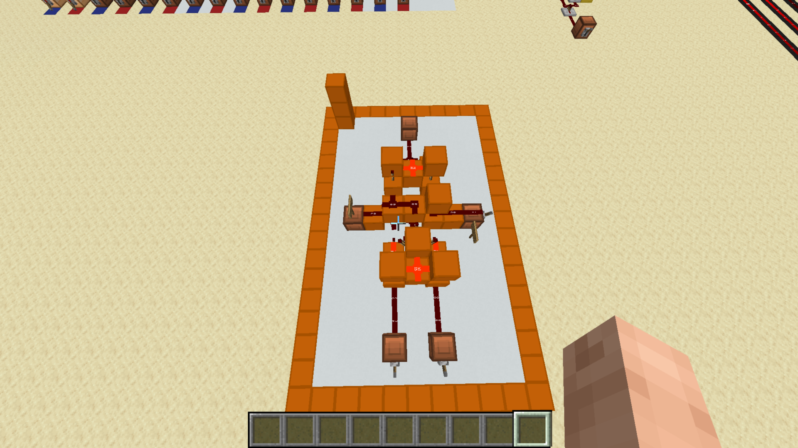

# Full Adder

[Component library](../README.md) · [Ripple-carry adder](../ripple-carry-adder/README.md)

A full adder adds two one-bit inputs and a carry-in. It produces a sum bit and carry-out, allowing multiple stages to be chained into a wider adder.

The screenshot shows the separate full-adder example. The physical input, carry, and output connections still need labels.

## Logic

`sum = A XOR B XOR carry_in`

`carry_out = (A AND B) OR (carry_in AND (A XOR B))`

| A | B | Carry-in | Sum | Carry-out |
| --- | --- | --- | --- | --- |
| 0 | 0 | 0 | 0 | 0 |
| 0 | 0 | 1 | 1 | 0 |
| 0 | 1 | 0 | 1 | 0 |
| 0 | 1 | 1 | 0 | 1 |
| 1 | 0 | 0 | 1 | 0 |
| 1 | 0 | 1 | 0 | 1 |
| 1 | 1 | 0 | 0 | 1 |
| 1 | 1 | 1 | 1 | 1 |

This is the logical truth table, not a record of exhaustive tests of this build. Any design-source credit for the physical layout remains to be documented.
