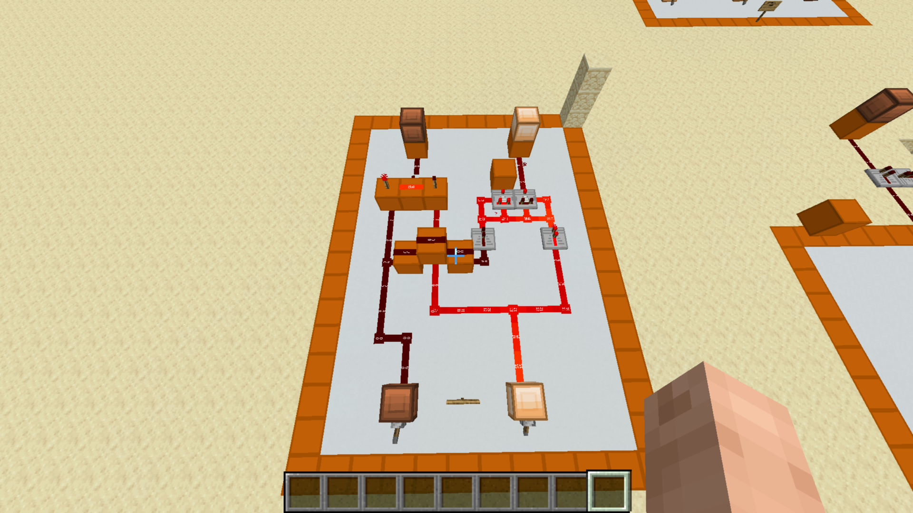

# Half Adder

[Component library](../README.md) · [Full adder](../full-adder/README.md)

A half adder adds two one-bit inputs, A and B. It produces a sum bit and a carry bit and has no carry-in input.

The two lower levers control the inputs. Two upper indicators show the output bits; their sum/carry labels still need to be marked on the screenshot.

## Logic

`sum = A XOR B`

`carry = A AND B`

| A | B | Sum | Carry |
| --- | --- | --- | --- |
| 0 | 0 | 0 | 0 |
| 0 | 1 | 1 | 0 |
| 1 | 0 | 1 | 0 |
| 1 | 1 | 0 | 1 |

Two ones add to binary `10`: sum 0 with carry 1. These are the logical results, not a record of exhaustive in-world testing.

## Details to document

- Label the sum and carry indicators
- Record any design source for this physical layout
- Identify any specific use of this standalone design in a larger build
