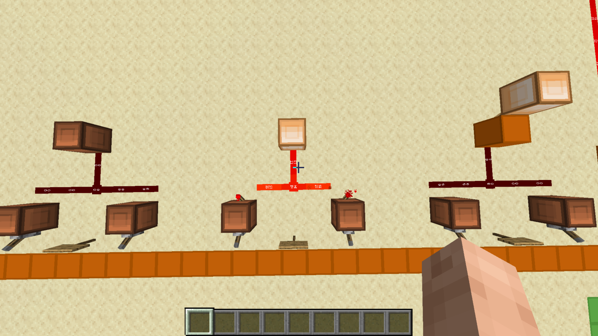

# NAND Gate

[Component library](../README.md) · [Project overview](../../README.md)

A NAND gate outputs 0 only when both inputs are 1. Its output is the inverse of AND.

The central circuit is the NAND example identified by the builder.

## Logic

`output = NOT (A AND B)`

| A | B | Output |
| --- | --- | --- |
| 0 | 0 | 1 |
| 0 | 1 | 1 |
| 1 | 0 | 1 |
| 1 | 1 | 0 |

Here, 1 means powered and 0 means unpowered. The table describes the logic; a single screenshot does not establish a complete test of the gate. The exact physical input labels and any design-source credits remain to be documented.

