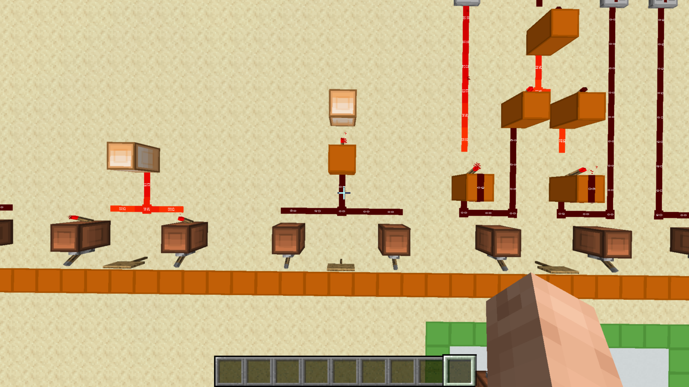

# NOR Gate

[Component library](../README.md) · [Project overview](../../README.md)

A NOR gate outputs 1 only when both inputs are 0. Its output is the inverse of OR.

The central two-input circuit combines the inputs before an output inversion. The visible wiring suggests a NOR layout: the combined input signal is inverted at the output.

## Logic

`output = NOT (A OR B)`

| A | B | Output |
| --- | --- | --- |
| 0 | 0 | 1 |
| 0 | 1 | 0 |
| 1 | 0 | 0 |
| 1 | 1 | 0 |

Here, 1 means powered and 0 means unpowered.
