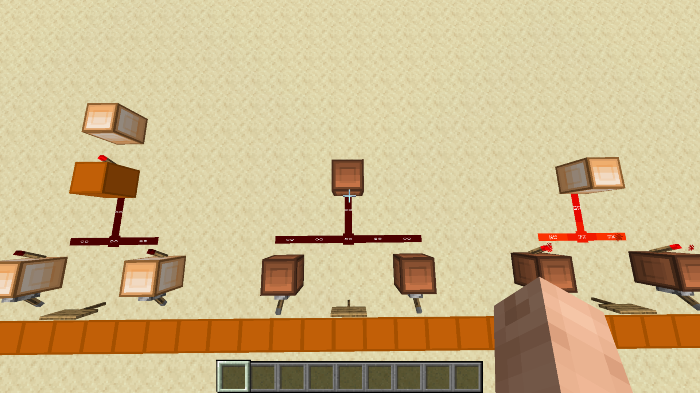

# OR Gate

[Component library](../README.md) · [Project overview](../../README.md)

An OR gate outputs 1 when either input, or both inputs, are 1.

The central circuit joins two input paths into a common output path.

## Logic

`output = A OR B`

| A | B | Output |
| --- | --- | --- |
| 0 | 0 | 0 |
| 0 | 1 | 1 |
| 1 | 0 | 1 |
| 1 | 1 | 1 |

Here, 1 means powered and 0 means unpowered. The table describes the logic; a single screenshot does not establish a complete test of the gate. The exact physical input labels and any design-source credits remain to be documented.

