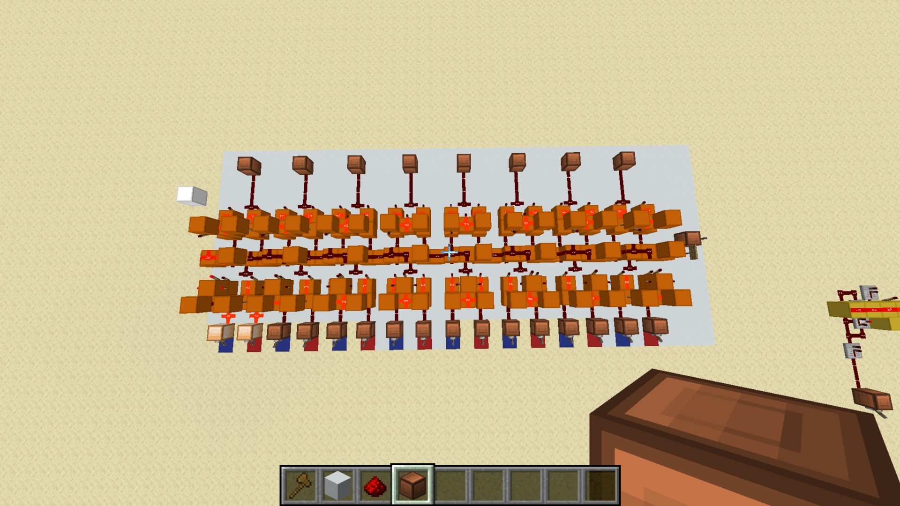

# Ripple-Carry Adders

[Component library](../README.md) · [Calculator](../../calculator/README.md)

## Eight-bit standalone adder

This adder combines two eight-bit numbers. It has eight bit positions, rather than eight independent number inputs: each position receives one bit from A and one from B. Carry propagates from one position to the next. A final carry-out can extend the result to nine bits.

The paired input indicators sit along the lower edge and the eight sum indicators along the upper edge. The physical carry-in, carry-out, and bit order still need to be labeled.

## Four-bit standalone example

This separate example demonstrates a four-bit ripple-carry adder. Each bit's carry-out feeds the next more significant bit's carry-in. The calculator uses two ripple-carry adders with eight-bit input values.

## Logic

Each full-adder stage follows these relationships:

`sum = A XOR B XOR carry_in`

`carry_out = (A AND B) OR (carry_in AND (A XOR B))`

| A | B | Carry-in | Sum | Carry-out |
| --- | --- | --- | --- | --- |
| 0 | 0 | 0 | 0 | 0 |
| 0 | 0 | 1 | 1 | 0 |
| 0 | 1 | 0 | 1 | 0 |
| 0 | 1 | 1 | 0 | 1 |
| 1 | 0 | 0 | 1 | 0 |
| 1 | 0 | 1 | 0 | 1 |
| 1 | 1 | 0 | 0 | 1 |
| 1 | 1 | 1 | 1 | 1 |

This is the logical truth table, not a record of exhaustive tests of the pictured build.

## Calculator implementation

The first adder handles addition or two's-complement subtraction. The second converts negative subtraction results into positive magnitudes. See the [installed arithmetic stage](../../calculator/COMPONENTS.md#two-adder-arithmetic-stage-in-the-calculator).

## Details to document

- Input, sum, and carry labels on the standalone screenshot
- Intermediate bit widths in the calculator
- Design source for this particular layout
