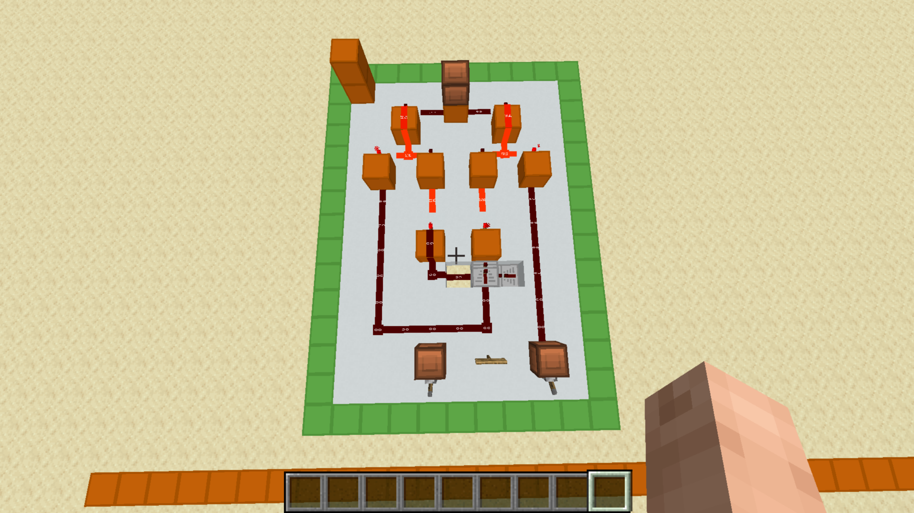

# XOR Gate

[Component library](../README.md) · [Project overview](../../README.md)

An XOR gate outputs 1 when its two inputs differ.

The green-bordered standalone circuit has two input levers at the lower end and an output indicator at the upper end.

`output = A XOR B`

| A | B | Output |
| --- | --- | --- |
| 0 | 0 | 0 |
| 0 | 1 | 1 |
| 1 | 0 | 1 |
| 1 | 1 | 0 |

Here, 1 means powered and 0 means unpowered. This table describes XOR logic rather than an exhaustive test of the pictured circuit. XOR supplies the sum function in a [half adder](../half-adder/README.md) and is part of [full-adder logic](../full-adder/README.md). Exact wiring labels and design-source credits for this layout remain to be documented.
